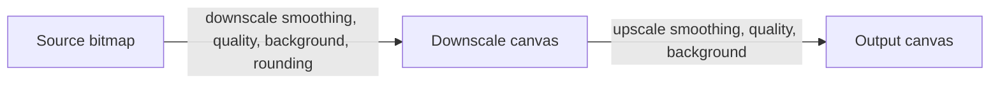

# Pixelation options

Replace `pixelate?: number` with `pixelation?: PixelationOptions`. This is a breaking change. Do not keep a numeric alias.

`pixelation` is one object: a block size, plus a downscale stage and an upscale stage. Each stage has its own smoothing, quality, and background. Rounding belongs on the downscale stage, because that stage chooses the cell grid. There is no `algorithm` field. The presets are the two algorithms.

## Public types

Add [`src/pixelation.ts`](src/pixelation.ts):

```ts
export type PixelationRounding = "floor" | "round";
export type PixelationSmoothingQuality = "low" | "medium" | "high";

export interface PixelationScaleOptions {
  /** `imageSmoothingEnabled` for this draw. */
  smoothing?: boolean;
  /**
   * `imageSmoothingQuality` for this draw.
   * Applies when `smoothing` is true. Default `"low"` (bilinear).
   */
  quality?: PixelationSmoothingQuality;
  /**
   * Fill this canvas before the draw.
   * `null` keeps it transparent.
   * Omit to use the top-level `background` option.
   */
  background?: string | null;
}

export interface PixelationDownscaleOptions extends PixelationScaleOptions {
  /**
   * Cell count is `max(1, rounding(size / blockSize))`.
   * Default `"floor"`.
   */
  rounding?: PixelationRounding;
}

export interface PixelationOptions {
  /** Target block size in output pixels. Must be >= 2. */
  blockSize: number;
  downscale?: PixelationDownscaleOptions;
  upscale?: PixelationScaleOptions;
}
```

Presets omit `background`, so a call-site `background` still fills both stages:

```ts
export const smoothPixelation = {
  blockSize: 8,
  downscale: { smoothing: true, quality: "low", rounding: "floor" },
  upscale: { smoothing: false, quality: "low" },
} as const satisfies PixelationOptions;

export const nearestPixelation = {
  blockSize: 8,
  downscale: { smoothing: false, quality: "low", rounding: "round" },
  upscale: { smoothing: false, quality: "low" },
} as const satisfies PixelationOptions;

export const pixelationPresets = {
  smooth: smoothPixelation,
  nearest: nearestPixelation,
} as const;
```

`smoothPixelation` is the current filter: bilinear shrink, nearest enlarge, `floor`. `nearestPixelation` is nearest-neighbor on both draws, with `round`.

Export the types and the three values from [`src/index.ts`](src/index.ts). Re-export the types from [`src/emojiToImage.ts`](src/emojiToImage.ts) and [`src/emojiToSvg.ts`](src/emojiToSvg.ts) next to the existing option types. Keep `resolvePixelation` internal to `src/pixelation.ts` (tests may import it from there).

## Resolution rules

`resolvePixelation(pixelation, fallbackBackground)` returns `null` when `pixelation` is omitted. That path draws at full resolution and is unchanged.

When the object is present:

- `blockSize` must be a finite number `>= 2`. Otherwise throw `IncompatibleOptionsError`.
- Omitted stage fields use these defaults: downscale `smoothing: true`, `quality: "low"`, `rounding: "floor"`; upscale `smoothing: false`, `quality: "low"`.
- A stage `background` of `undefined` uses `fallbackBackground`. Explicit `null` stays transparent even when the top-level background is set.
- Cell count is `Math.max(1, roundOrFloor(size / blockSize))`. The low-res canvas is then stretched to `size`. Do not snap to a uniform `blockSize` grid. Non-divisible sizes keep mixed block widths.
- `quality` is set on the context for the draw. Canvas ignores it while smoothing is off. Still store it on the stage so a preset can turn smoothing on later without losing quality.

`{ blockSize: 8 }` with neither stage set matches today's `pixelate: 8` on an even split such as 72: bilinear shrink, nearest enlarge, `floor`, and the top-level background painted on both canvases.



## Call sites

Remove `pixelate` from:

- [`src/types.ts`](src/types.ts) (`EmojiToSvgOptions`, `EmojiToImageOptions`)
- [`src/svgToImage.ts`](src/svgToImage.ts) (`SvgToImageOptions`, `drawImageToContext`)
- [`src/nativeToImage.ts`](src/nativeToImage.ts)
- [`src/emojiToImage.ts`](src/emojiToImage.ts), including `RenderEmojiBlobOptions` and every place that forwards `pixelate` into the blob, srcset, native, and SVG raster paths
- [`src/emojiToSvg.ts`](src/emojiToSvg.ts)

`drawImageToContext(context, image, size, background, pixelation?)` keeps `background` as the fallback color and passes it into `resolvePixelation`.

Non-pixelated drawing stays as it is: if `background !== null`, fill the output, then `drawImage` at `size`. Do not change smoothing on that path.

Pixelated drawing:

1. Create the scratch canvas at the cell count.
2. Fill it when the resolved downscale background is non-null.
3. Set the scratch context's `imageSmoothingEnabled` and `imageSmoothingQuality`, then draw the source into `cells × cells`.
4. Fill the output when the resolved upscale background is non-null.
5. Set the output context's smoothing and quality, draw the scratch canvas to `size` with the 9-argument `drawImage`, then set the output context's `imageSmoothingEnabled` back to `true` and `imageSmoothingQuality` back to `"low"`. Existing tests expect smoothing to be left on.

Add `imageSmoothingQuality` to the local `DrawableContext` in [`src/svgToImage.ts`](src/svgToImage.ts) and to `MinimalCanvasContext2D` in [`src/canvasEnv.ts`](src/canvasEnv.ts).

Native text, in [`src/nativeToImage.ts`](src/nativeToImage.ts): when `pixelation` is set, render the glyph canvas with no background, then let `drawImageToContext` apply the stage backgrounds. When `pixelation` is omitted, keep filling the top-level background on the text canvas.

`emojiToSvg`: validate `pixelation` before the responsive check. `responsive` together with `pixelation` still throws `IncompatibleOptionsError` (`responsive is incompatible with pixelation on emojiToSvg because pixelated output embeds a raster image`). A present `pixelation` still forces `xmlDeclaration: false` on the inner normalized SVG, rasterizes through `svgToDataUrl`, and wraps the PNG with `wrapRasterSvg`.

Srcset and responsive image rendering pass the same `pixelation` object through at every physical width. Block size stays constant while the cell count follows each render size.

## Tests

Update every `pixelate: 8` call. Use `{ pixelation: { blockSize: 8 } }` where the old default behavior is under test, and the presets where the test is about an algorithm.

Give each canvas its own 2D context. The current tests return one shared context from `getContext`, which cannot tell the downscale flags from the upscale flags. Context order:

- `svgToImage`: output canvas, then scratch canvas.
- Native with pixelation: text canvas, output canvas, then scratch canvas.

Assert:

- `{ blockSize: 8 }` on size 32 leaves the scratch smoothing on and the output smoothing off during the enlarge, then restores output smoothing to `true`. `drawImage` runs twice. Scratch destination size is `Math.floor(32 / 8) === 4`.
- `nearestPixelation` with `blockSize: 8` turns smoothing off on both draws. Size 100 and block 6 uses `Math.round(100 / 6) === 17` cells. The same size with `rounding: "floor"` uses 16.
- Top-level `background: "#fff"` fills both the scratch canvas and the output canvas.
- `downscale: { background: null }` with `upscale: { background: "#fff" }` fills only the output, at full size.
- `blockSize: 1` throws `IncompatibleOptionsError` from `emojiToImage`, `emojiToSvg`, and `svgToImage`.
- `emojiToSvg` with `responsive: true` and `pixelation: { blockSize: 8 }` throws.
- `emojiToSvg` with `pixelation: smoothPixelation` still returns a raster-backed SVG.
- Native pixelation with a top-level background does not fill the text canvas. The stage canvases receive the fill.
- [`e2e/emojiToImage.browser.test.ts`](e2e/emojiToImage.browser.test.ts) uses `pixelation: { blockSize: 8 }` and still expects a different image from the sharp render.

Add direct `resolvePixelation` tests for omitted input (`null`), default stage values, explicit `null` background versus fallback, and non-finite `blockSize`.

## Docs and Storybook

In [`README.md`](README.md), replace the `pixelate` option row, the two call examples, and the responsive-incompatibility sentence. Show:

```ts
import { emojiToImage, emojiToSvg, nearestPixelation, pixelationPresets } from "emoji-renderer";

await emojiToSvg("👾", { size: 96, pixelation: pixelationPresets.smooth });

await emojiToImage("👾", {
  size: 96,
  background: "#fff",
  pixelation: {
    ...nearestPixelation,
    blockSize: 6,
    downscale: { ...nearestPixelation.downscale, background: null },
  },
});
```

Document the stage fields, the `{ blockSize: 8 }` default, and that `quality` has no effect while smoothing is off.

In [`src/emojiToImage.stories.ts`](src/emojiToImage.stories.ts) and [`src/emojiToSvg.stories.ts`](src/emojiToSvg.stories.ts), remove the numeric `pixelate` control. Build `pixelation` from a preset select (`off`, `smooth`, `nearest`) plus a `blockSize` number. Spread the chosen preset and override `blockSize` when the select is not `off`. Add one story that passes a custom downscale or upscale override (smoothing, quality, or a stage background of `null`) so the stage fields are visible in the docs source.

Run `vp check` and `vp test`.
