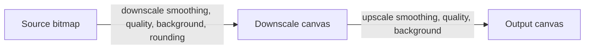

# Pixelation options

This is additive. Keep `pixelate?: number` on the public options, with the same pixels as today. Add `pixelation?: PixelationOptions` beside it.

Leave a source comment on every `pixelate` option and every coercion that exists only to accept it. Grep `v2: remove` to find them. v2 deletes those options, the coercion, the deprecation warning, and the tests and docs that exist for them. `pixelation`, the presets, and `resolvePixelation` stay.

`pixelation` is one object: a block size, plus a downscale stage and an upscale stage. Each stage has its own smoothing, quality, and background. Rounding belongs on the downscale stage, because that stage chooses the cell grid. There is no `algorithm` field. The presets are the two algorithms.

## Public types

Leave `pixelate?: number` in place on `EmojiToSvgOptions`, `EmojiToImageOptions`, `SvgToImageOptions`, and `NativeToImageOptions`. Mark it `@deprecated` and point the JSDoc at `pixelation`. Values below 2 still mean "off" and do not warn. Values `>= 2` still mean a block size of that many output pixels.

```ts
/**
 * Block size in output pixels. Values >= 2 pixelate.
 * @deprecated Use `pixelation`.
 * v2: remove this pixelate option.
 */
pixelate?: number;
```

Add [`src/pixelation.ts`](src/pixelation.ts):

```ts
export type PixelationRounding = "floor" | "round";
export type PixelationSmoothingQuality = "low" | "medium" | "high";

export interface PixelationScaleOptions {
  /** `imageSmoothingEnabled` for this draw. */
  smoothing?: boolean;
  /**
   * `imageSmoothingQuality` for this draw.
   * Applies when `smoothing` is true. Default `"low"` (bilinear).
   */
  quality?: PixelationSmoothingQuality;
  /**
   * Fill this canvas before the draw.
   * `null` keeps it transparent.
   * Omit to use the top-level `background` option.
   */
  background?: string | null;
}

export interface PixelationDownscaleOptions extends PixelationScaleOptions {
  /**
   * Cell count is `max(1, rounding(size / blockSize))`.
   * Default `"floor"`.
   */
  rounding?: PixelationRounding;
}

export interface PixelationOptions {
  /** Target block size in output pixels. Must be >= 2. */
  blockSize: number;
  downscale?: PixelationDownscaleOptions;
  upscale?: PixelationScaleOptions;
}
```

Presets omit `background`, so a call-site `background` still fills both stages:

```ts
export const smoothPixelation = {
  blockSize: 8,
  downscale: { smoothing: true, quality: "low", rounding: "floor" },
  upscale: { smoothing: false, quality: "low" },
} as const satisfies PixelationOptions;

export const nearestPixelation = {
  blockSize: 8,
  downscale: { smoothing: false, quality: "low", rounding: "round" },
  upscale: { smoothing: false, quality: "low" },
} as const satisfies PixelationOptions;

export const pixelationPresets = {
  smooth: smoothPixelation,
  nearest: nearestPixelation,
} as const;
```

`smoothPixelation` is the current `pixelate` filter: bilinear shrink, nearest enlarge, `floor`. `nearestPixelation` is nearest-neighbor on both draws, with `round`. `{ blockSize: 8 }` with neither stage set matches `pixelate: 8` on an even split such as 72.

Export the types and the three values from [`src/index.ts`](src/index.ts). Re-export the types from [`src/emojiToImage.ts`](src/emojiToImage.ts) and [`src/emojiToSvg.ts`](src/emojiToSvg.ts) next to the existing option types.

## Coercion and deprecation

Add `coercePixelation({ pixelate, pixelation })` in `src/pixelation.ts`. Public entry points call it once and pass the result downstream. Downstream drawing takes `PixelationOptions | undefined` only, so the warning cannot fire twice for one call.

```ts
// v2: remove this pixelate coercion, the deprecation warning, and resetPixelateDeprecationForTests.
export function coercePixelation(options: {
  pixelate?: number;
  pixelation?: PixelationOptions;
}): PixelationOptions | null
```

- Neither option: return `null`. Draw at full resolution, unchanged.
- `pixelate` below 2, and no `pixelation`: return `null`. No warning. `// v2: remove this pixelate coercion.`
- `pixelate >= 2`, and no `pixelation`: warn, then return `{ blockSize: pixelate }`. That uses the smooth defaults, which is today's behavior. `// v2: remove this pixelate coercion.`
- `pixelation` set, with or without `pixelate`: use `pixelation` as given. Do not merge `pixelate` into `blockSize` or the stages. If `pixelate >= 2` as well, still warn. `// v2: remove the pixelate branch of this coercion.` The `pixelation` branch stays.

Warn with `console.warn`, once per process. `// v2: remove this deprecation warning.`

```txt
pixelate is deprecated and will be removed in a future major version. Use pixelation: { blockSize: N } or smoothPixelation instead.
```

Do not throw. A thrown error would break current callers. Use a module-level flag so srcset widths and repeated renders warn once. Export `resetPixelateDeprecationForTests()` next to the other test resetters, and call it from tests that assert the warning. `// v2: remove resetPixelateDeprecationForTests and the once-only flag.`

`pixelation.blockSize` must be a finite number `>= 2`. Otherwise throw `IncompatibleOptionsError`. That check applies only to the new object and stays in v2. `pixelate: 0` and `pixelate: 1` stay silent no-ops. `// v2: remove this pixelate no-op.`

## Resolution rules

`resolvePixelation(pixelation, fallbackBackground)` turns a coerced object into concrete stage settings. It returns `null` when coercion returned null.

When the object is present:

- Omitted stage fields use these defaults: downscale `smoothing: true`, `quality: "low"`, `rounding: "floor"`; upscale `smoothing: false`, `quality: "low"`.
- A stage `background` of `undefined` uses `fallbackBackground`. Explicit `null` stays transparent even when the top-level background is set.
- Cell count is `Math.max(1, roundOrFloor(size / blockSize))`. The low-res canvas is then stretched to `size`. Do not snap to a uniform `blockSize` grid. Non-divisible sizes keep mixed block widths.
- `quality` is set on the context for the draw. Canvas ignores it while smoothing is off. Still store it on the stage so a preset can turn smoothing on later without losing quality.



## Call sites

Keep `pixelate` and add `pixelation` on the option interfaces below. `// v2: remove the pixelate option from each of these interfaces.`

- [`src/types.ts`](src/types.ts) (`EmojiToSvgOptions`, `EmojiToImageOptions`)
- [`src/svgToImage.ts`](src/svgToImage.ts) (`SvgToImageOptions`)
- [`src/nativeToImage.ts`](src/nativeToImage.ts)
- [`src/emojiToImage.ts`](src/emojiToImage.ts), including `RenderEmojiBlobOptions` and every place that forwards pixelation into the blob, srcset, native, and SVG raster paths
- [`src/emojiToSvg.ts`](src/emojiToSvg.ts)

Coerce at `emojiToImage`, `emojiToSvg`, `svgToImageBlob`, and `nativeEmojiToImageBlob`. `// v2: remove these coercePixelation calls and pass pixelation through.` After that, forward only the resolved `PixelationOptions | undefined`. `emojiToImage` currently rasterizes SVG without passing `pixelate` into `emojiToSvg`, then pixelates in `svgToImageBlob`. Keep that split: coerce in `emojiToImage` and pass `pixelation` into `svgToImageBlob`, so a `pixelate` number on `emojiToImage` does not go through `emojiToSvg`. `// v2: remove this pixelate split; pixelation is the only input.`

`drawImageToContext(context, image, size, background, pixelation?)` keeps `background` as the fallback color and passes it into `resolvePixelation`.

Non-pixelated drawing stays as it is: if `background !== null`, fill the output, then `drawImage` at `size`. Do not change smoothing on that path.

Pixelated drawing:

1. Create the scratch canvas at the cell count.
2. Fill it when the resolved downscale background is non-null.
3. Set the scratch context's `imageSmoothingEnabled` and `imageSmoothingQuality`, then draw the source into `cells × cells`.
4. Fill the output when the resolved upscale background is non-null.
5. Set the output context's smoothing and quality, draw the scratch canvas to `size` with the 9-argument `drawImage`, then set the output context's `imageSmoothingEnabled` back to `true` and `imageSmoothingQuality` back to `"low"`. Existing tests expect smoothing to be left on.

Add `imageSmoothingQuality` to the local `DrawableContext` in [`src/svgToImage.ts`](src/svgToImage.ts) and to `MinimalCanvasContext2D` in [`src/canvasEnv.ts`](src/canvasEnv.ts).

Native text, in [`src/nativeToImage.ts`](src/nativeToImage.ts): when coercion returns a pixelation object (from `pixelate >= 2` or from `pixelation`), render the glyph canvas with no background, then let `drawImageToContext` apply the stage backgrounds. When coercion returns null, keep filling the top-level background on the text canvas. `// v2: remove the pixelate >= 2 branch of this check.`

`emojiToSvg`: coerce before the responsive check. `responsive` together with an active pixelation (either `pixelate >= 2` or a `pixelation` object) still throws `IncompatibleOptionsError`. Keep the existing message for `pixelate`, and use `responsive is incompatible with pixelation on emojiToSvg because pixelated output embeds a raster image` when the object is set. `// v2: remove the pixelate >= 2 check and its error message.` An active pixelation still forces `xmlDeclaration: false` on the inner normalized SVG, rasterizes through `svgToDataUrl`, and wraps the PNG with `wrapRasterSvg`.

Srcset and responsive image rendering pass the coerced object through at every physical width. Block size stays constant while the cell count follows each render size. Coerce once before the srcset loop so the deprecation warning is not repeated per width. `// v2: remove this once-only coercion; pass pixelation through the loop.`

## Tests

Leave the existing `pixelate: 8` tests in place. They must keep producing the same draw sizes and the same final `imageSmoothingEnabled: true`. `// v2: remove these pixelate tests.` Add an assertion in one of them that `console.warn` is called once with the deprecation message, and is not called again on a second `pixelate: 8` render until `resetPixelateDeprecationForTests()`. `// v2: remove this deprecation test and the reset helper.`

Give new pixelation tests their own 2D context per canvas. The current shared `getContext` mock cannot tell downscale flags from upscale flags. Context order:

- `svgToImage`: output canvas, then scratch canvas.
- Native with pixelation: text canvas, output canvas, then scratch canvas.

Assert:

- `pixelate: 8` on size 32 still uses scratch size `Math.floor(32 / 8) === 4`, scratch smoothing on, output smoothing off during the enlarge, then restored to `true`. `// v2: remove this pixelate assertion.`
- `pixelate: 0` and `pixelate: 1` do not warn and do not create a scratch canvas. `// v2: remove this pixelate assertion.`
- `{ pixelation: { blockSize: 8 } }` matches that `pixelate: 8` draw and does not warn.
- `pixelation` together with `pixelate: 4` follows `pixelation` and still warns. `// v2: remove this pixelate assertion.`
- `nearestPixelation` with `blockSize: 8` turns smoothing off on both draws. Size 100 and block 6 uses `Math.round(100 / 6) === 17` cells. The same size with `rounding: "floor"` uses 16.
- Top-level `background: "#fff"` fills both the scratch canvas and the output canvas for both `pixelate: 8` and `{ blockSize: 8 }`. `// v2: remove the pixelate: 8 half of this assertion.`
- `downscale: { background: null }` with `upscale: { background: "#fff" }` fills only the output, at full size.
- `pixelation: { blockSize: 1 }` throws `IncompatibleOptionsError` from `emojiToImage`, `emojiToSvg`, and `svgToImage`. `pixelate: 1` does not throw. `// v2: remove the pixelate: 1 assertion.`
- `emojiToSvg` with `responsive: true` and `pixelate: 8` still throws. The same call with `pixelation: { blockSize: 8 }` throws. `pixelate: 1` with `responsive: true` does not throw. `// v2: remove the pixelate assertions.`
- `emojiToSvg` with `pixelation: smoothPixelation` returns a raster-backed SVG.
- Native pixelation, whether from `pixelate: 8` or from a `pixelation` object, does not fill the text canvas when a top-level background is set. The stage canvases receive the fill. `// v2: remove the pixelate: 8 case.`
- [`e2e/emojiToImage.browser.test.ts`](e2e/emojiToImage.browser.test.ts) keeps `pixelate: 8` and still expects a different image from the sharp render. `// v2: remove this pixelate call and switch the test to pixelation.`

Add direct coercion and `resolvePixelation` tests for omitted input (`null`), default stage values, explicit `null` background versus fallback, and non-finite `blockSize`. `// v2: remove the coercePixelation tests that pass pixelate. Keep the resolvePixelation tests.`

## Docs and Storybook

In [`README.md`](README.md), keep the `pixelate` row and mark it deprecated. `// v2: remove this pixelate option row.` Add a `pixelation` row. Keep a `pixelate: 8` example so the old call still appears. `// v2: remove this pixelate example.` Add:

```ts
import { emojiToImage, emojiToSvg, nearestPixelation, pixelationPresets } from "emoji-renderer";

await emojiToSvg("👾", { size: 96, pixelation: pixelationPresets.smooth });

await emojiToImage("👾", {
  size: 96,
  background: "#fff",
  pixelation: {
    ...nearestPixelation,
    blockSize: 6,
    downscale: { ...nearestPixelation.downscale, background: null },
  },
});
```

Document the stage fields, the `{ blockSize: 8 }` default, that `quality` has no effect while smoothing is off, and that `pixelation` wins when both options are set. `// v2: remove the sentence that says pixelation wins over pixelate.`

In [`src/emojiToImage.stories.ts`](src/emojiToImage.stories.ts) and [`src/emojiToSvg.stories.ts`](src/emojiToSvg.stories.ts), keep the numeric `pixelate` control. `// v2: remove this pixelate control.` Add a preset select (`off`, `smooth`, `nearest`) and a `blockSize` number that build `pixelation` by spreading the chosen preset and overriding `blockSize`. When the select is `off`, omit `pixelation` and leave `pixelate` in charge. `// v2: remove the pixelate fallback in that off state.` Add one story that passes a custom downscale or upscale override (smoothing, quality, or a stage background of `null`) so the stage fields are visible in the docs source.

Run `vp check` and `vp test`.
